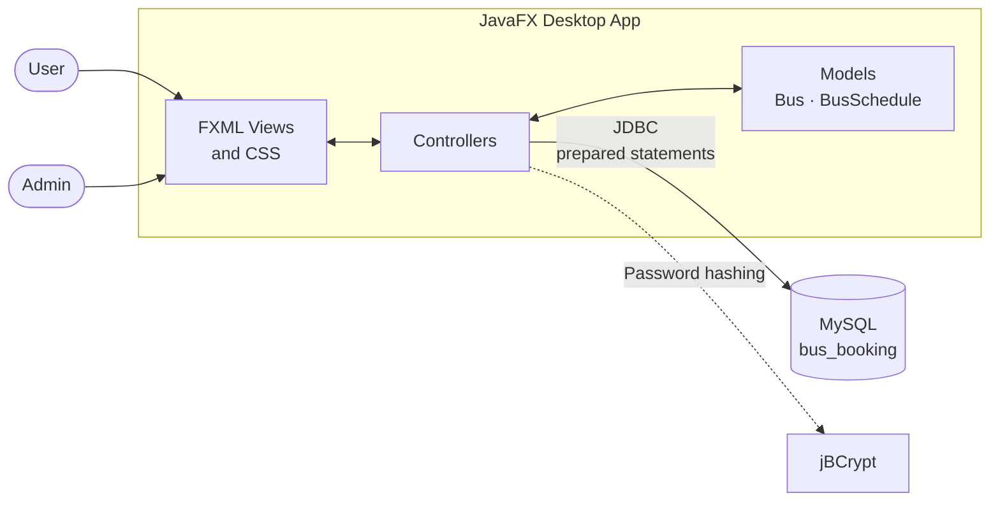
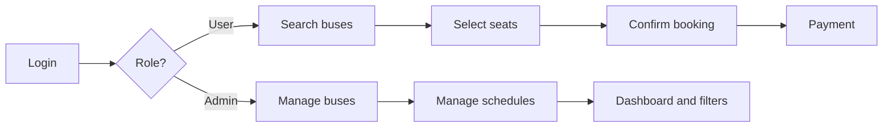

<div align="center">

# Online Bus Booking Platform

**A JavaFX desktop app for searching buses, picking seats, and booking tickets, with a full admin dashboard.**


</div>

---

## Overview

The Online Bus Booking Platform streamlines ticket booking with two separate experiences. Users search for buses, choose seats on an interactive layout, and pay. Admins manage buses and schedules from a dashboard.

---

## Features

| Role | Capabilities |
|------|--------------|
| **User** | Registration and login, bus search by source, destination, and date, interactive seat selection with live availability, booking confirmation, payment |
| **Admin** | Add, view, and delete buses, create schedules with dates and times, dashboard table of all buses and schedules, date filters (Today, Tomorrow, Onward), automatic cleanup of expired schedules |
| **Security** | BCrypt password hashing, prepared statements against SQL injection, session management, role-based access (Admin / User) |

---

## How It Works



### Role-Based Flow



---

## Tech Stack

| Layer | Technology |
|-------|------------|
| **Language** | Java 21 |
| **GUI** | JavaFX 21.0.6 with FXML and CSS |
| **Database** | MySQL with MySQL Connector/J 9.2.0 |
| **Security** | jBCrypt 0.4 |
| **Build** | Manual compilation with `javac` |

---

## Getting Started

### Prerequisites

- JDK 21 or later
- MySQL Server 8.0 or later
- Git

JavaFX SDK 21.0.6 and the required libraries are already included in the `lib/` folder.

### 1. Clone the repository

```bash
git clone https://github.com/your-username/online-bus-booking-platform.git
cd online-bus-booking-platform
```

### 2. Set up the database

Create the database and import the schema:

```sql
CREATE DATABASE bus_booking;
```

Then run `bus_booking.sql` in your MySQL client. It creates four tables: `users`, `buses`, `bus_schedule`, and `bookings`.

### 3. Configure the connection

Open `src/database/DatabaseConnection.java` and set your MySQL details:

```java
private static final String URL = "jdbc:mysql://localhost:3306/bus_booking";
private static final String USER = "your_mysql_username";
private static final String PASSWORD = "your_mysql_password";
```

### 4. Compile

```bash
javac -cp "lib/*" -d bin src/**/*.java
```

### 5. Run

**Linux / macOS**

```bash
java -cp "bin:lib/*" --module-path lib/javafx-sdk-21.0.6/lib --add-modules javafx.controls,javafx.fxml Main
```

**Windows** (uses `;` instead of `:`)

```bash
java -cp "bin;lib/*" --module-path lib/javafx-sdk-21.0.6/lib --add-modules javafx.controls,javafx.fxml Main
```

---

## Usage

| Step | User | Admin |
|------|------|-------|
| 1 | Register or log in | Log in with admin credentials |
| 2 | Search by source, destination, and date | Add or delete buses |
| 3 | Select a bus | Create schedules with dates and times |
| 4 | Pick seats on the layout | Monitor buses and schedules with filters |
| 5 | Confirm the booking | Expired schedules are removed automatically |
| 6 | Complete payment | |

---

## Project Structure

```
online-bus-booking-platform/
├── src/
│   ├── Main.java                 # Entry point
│   ├── controllers/              # Login, Register, Admin, User,
│   │                             # UserBooking, Payment, AddBus, AddSchedule
│   ├── models/                   # Bus, BusSchedule
│   ├── database/                 # DatabaseConnection
│   └── views/                    # FXML files (login, register, dashboards,
│                                 # booking, payment, addBus, addSchedule)
├── styles/                       # CSS: login, booking, userDashboard
├── images/                       # UI images and logos
├── lib/                          # JavaFX SDK, MySQL connector, jBCrypt
├── bin/                          # Compiled classes
└── bus_booking.sql               # Database schema
```

---

## Contributing

Contributions are welcome.

1. Fork the repository
2. Create a branch: `git checkout -b feature/your-feature`
3. Commit your changes: `git commit -m "Add your feature"`
4. Push and open a pull request

Please follow Java naming conventions, comment complex logic, and test your changes before submitting.

---

## License

Released under the [MIT License](./LICENSE).

---

<div align="center">

Questions or issues? [Open an issue](../../issues) on GitHub.

</div>
